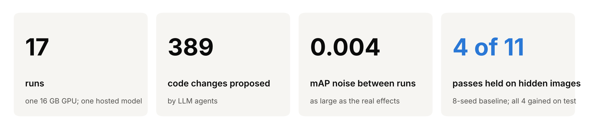
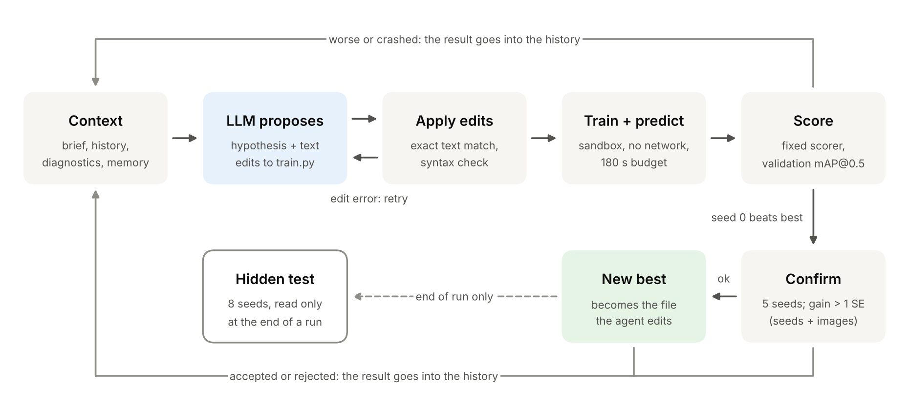
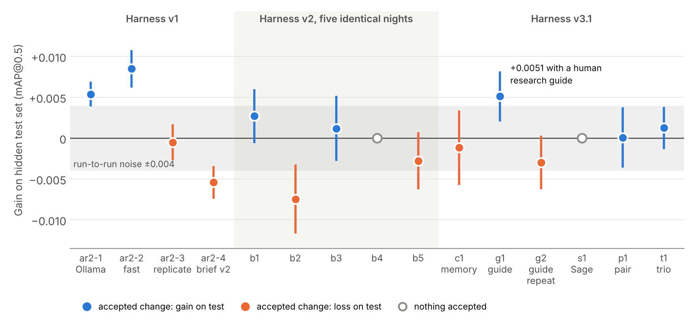
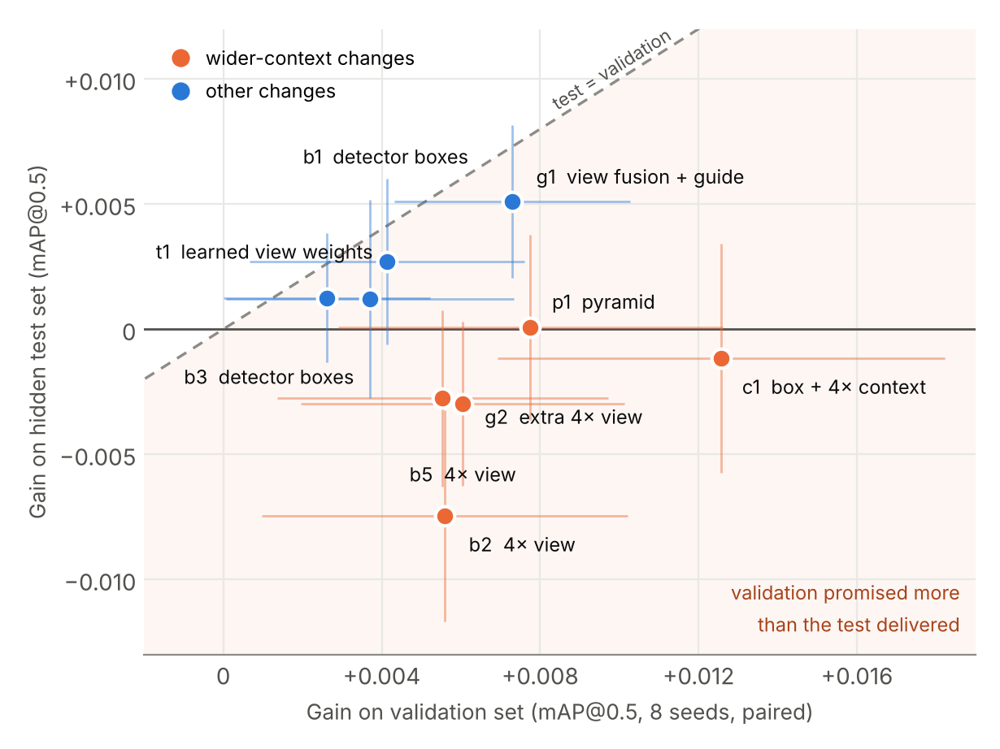
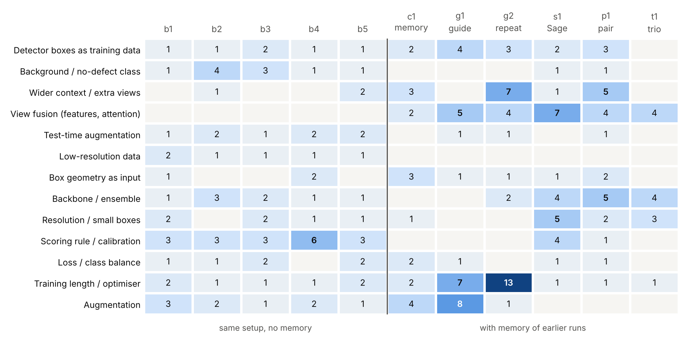
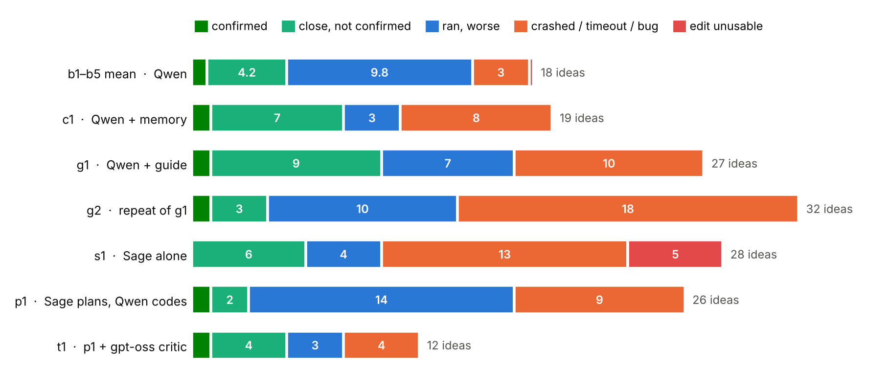
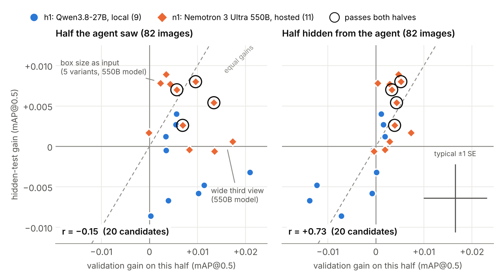

# Can a Local 27B LLM Do Autonomous ML Research? A Case Study on Two-Stage Weld-Defect Detection

November 2026

Technical report, version 1.0.

> **About this repository.** This README is the full report. The code that ran every experiment is in
> [`harness/`](harness/) (the loop `ar_loop.py`, the training start file `ar2_train.py`, the briefs, memory and guide,
> the launchers and the control scripts). Every run's log is in [`runs/<name>/`](runs/): `report.md`,
> `experiments.json`, `events.jsonl`, `meta.json`, and per experiment the prompt, the model's reply and thinking, the
> code diff and the training logs. The LoHi-WELD images and labels are not included; `harness/ar2_prepare.py` builds the
> task from the published dataset (Block et al., IEEE Access 2024). Code: Apache License 2.0. Report text and figures: CC BY 4.0.



## Abstract

We study whether a quantized 27B-parameter language model running on a single 16 GB workstation GPU can autonomously improve a real computer-vision system. The agent edits the second stage of a two-stage weld-defect detector (LoHi-WELD), one change per experiment, under a fixed 180 s training budget, a sandbox, a fixed metric and a hidden test set read only at the end of each run. Over 17 runs and 389 proposed changes we vary the harness, the acceptance rule, the prompt, the model (Qwen3.8-27B, Sage-A1.5), two- and three-model teams (planner, engineer, critic), a human-written research guide and, as a reference, a 550B-parameter open model on a hosted API. Engineering made the local agent practical (2.9 to 23 tokens/s at 100 W, no measurable quality loss, unusable edits from up to 50% of calls to 0%). Scientifically, the main result is negative but instructive: validation gains repeatedly failed to transfer to the hidden test set. Five times an idea that widened image context won validation, carried mostly by the smallest class, and gave no gain or a loss on test. We attribute this to selection on a fixed set of 164 validation images whose sampling noise (±0.003–0.005 mAP) is as large as seed noise and as large as the effects sought; a seed-plus-image bootstrap acceptance rule raised the bar but could not remove the bias. Hiding half of the validation images from the agent and confirming on them removed it. Across the 20 candidates of the two held-out runs, the gain on the visible half did not predict the test gain (r = −0.15), while the gain on the hidden half did (r = +0.73). As run, the gate rejected all 11 changes that passed on the visible half, because it compared them with only five seeds of the start file. Re-scored against all eight, it accepts 4 of the 11, all from the 550B model and all positive on test (+0.0026 to +0.0080), and rejects 7 whose test gains average −0.0016. A two-seed ensemble of the start file, a change known to help, passed the same gate and gained +0.0090 ± 0.0027 on test, while the unchanged file with fresh seeds was rejected. The largest test gain of a change accepted during a run (+0.0051 ± 0.0030 mAP@0.5) came from implementing a strategy written by a human; a repeat of that run reached the same idea but did not accept it. The local model behaves as a reliable research engineer but a weak research strategist; a model twenty times larger broke as many ideas but proposed better ones, and the quality of the validation signal limited progress more than either.

## Summary of findings

1. **A local 27B model is a practical research engineer.** Serving choices raised speed from 2.9 to 23 tokens/s at 100 W, and harness design cut unusable edits from up to 50% of calls to 0% (Section 4.1).
2. **Validation gains did not transfer.** Five accepted changes widened the image context. They gained +0.0055 to +0.0126 mAP on validation and between −0.0075 and +0.0001 on the hidden test set (Section 4.3, Figure 3).
3. **The noise is as large as the effects.** Seeds (SD 0.005), validation images (SE 0.002–0.005) and whole nights (SD 0.004) each vary as much as the real effects found, 0.002–0.008 mAP (Section 3).
4. **Human direction gave the largest gain accepted during a run, and its repeat did not confirm it.** With a one-page research guide, run g1 found a change worth +0.0051 ± 0.0030 mAP on the hidden test set. Its repeat g2 tried the same idea in its fourth experiment, missed the acceptance bar by 0.0002, and ended with a wider-context change that lost 0.0030 on test (Section 4.2).
5. **A model with stronger agent benchmarks did worse.** Sage-A1.5 alone confirmed nothing in 28 ideas and failed 47% of its calls. As planner for Qwen it lost no edits but gained +0.0001 on test. Adding gpt-oss-20b as a critic changed which ideas were tried, not the outcome: +0.0012 on test (Section 4.5).
6. **Confirming on hidden validation images separated real gains from noise.** With 82 of the 164 validation images hidden from the agent (runs h1 and n1), visible-half gains did not predict test gains (r = −0.15 over 20 candidates) and hidden-half gains did (r = +0.73). Against a baseline of eight seeds the gate passes 4 of the 11 visible-half winners, all positive on test, and rejects 7 whose test gains average −0.0016. As a check of the gate itself, a two-seed ensemble of the start file passes and gains +0.0090 on test, and the same file with fresh seeds is rejected (Section 4.6, Figure 6).
7. **The gate's baseline decided its verdicts.** As run, with five baseline seeds, it accepted none of the 11, because those five seeds were lucky on the hidden half by about 0.003 (Section 4.6).
8. **A model twenty times larger proposed better ideas, not more working ones.** Nemotron 3 Ultra (550B) broke 7 of its 19 ideas, against 8 of 19 for the local model. On test its candidates averaged +0.0044 against −0.0024, mostly through one idea, box size as a classifier input, worth about +0.008 on test, which the local model never got running (Section 4.6).
9. **The evaluation limits progress more than the model.** For a research loop on one GPU, effort is best spent on the validation protocol first (Section 5).

## 1 Introduction

LLM agents that propose, implement and evaluate changes to a training script ("autoresearch") have been demonstrated with frontier models on benchmark tasks \[1, 2, 3\]. Two questions are less explored: whether a model small enough to run offline on one consumer-class GPU can do the same on a real industrial task, and how much of any reported gain survives on data the agent never saw.

We ran this experiment on a home workstation (RTX A4000 16 GB, capped at 100 W) with LoHi-WELD \[4\], a weld-defect dataset with four classes (pore, deposit, discontinuity, stain). A fixed class-agnostic YOLOv7-tiny detector \[5\] proposes boxes; a crop classifier assigns classes; the agent may change only the classifier's training script. Every run ends with an evaluation on a hidden test set that the agent cannot read.

Contributions:

1. A reproducible, offline autoresearch harness for a 16 GB GPU: sandboxed execution, fixed metric, multi-seed confirmation, a paired image-bootstrap acceptance rule, diagnostics, cross-run memory, provenance hashes.
2. A measurement of the noise floor at three levels (seeds, validation images, whole runs) and of how acceptance rules interact with it.
3. Evidence, replicated five times, that gains selected on a fixed validation set did not transfer to the test set, and an analysis of why.
4. A held-out confirmation gate that hides half of the validation images from the agent, tried with the local model and with a 550B open model, with every candidate's test score and the gate's own limits.
5. A comparison of agent configurations on the same harness: one local model alone, a second local model (Sage-A1.5) alone, the two as planner and engineer with and without a third model as critic, the local model following a human research guide, run twice, and a much larger hosted model alone.
6. Practical findings on serving a 27B model locally: speculative decoding, quantization drift, and enforcing rather than requesting a thinking budget.

## 2 Experimental setup

### 2.1 Task

LoHi-WELD high-resolution images with the authors' split: 653 training, 164 validation and 205 test images (6,052 / 1,495 / 1,928 defect boxes). Stage 1 is a class-agnostic YOLOv7-tiny trained once and frozen (test mAP@0.5 0.780; paper 0.77). Stage 2, the part the agent edits, is a two-crop EfficientNet-B0 classifier (tight 1.5× and wide 2.5× crops around each box, 160 px, logits averaged). Each detector box yields one row per class with score = detector confidence × class probability. The metric is mAP@0.5 computed by a fixed scorer identical to YOLOv7's. Reference points: a one-stage 4-class YOLOv7-tiny reaches 0.685 on test; giving every detector box its correct class would reach about 0.75 on validation, so nearly all remaining error is the class decision on boxes that overlap a real defect.

### 2.2 Station and model serving

| Component | Setting |
| --- | --- |
| Hardware | HP Z2 G8, RTX A4000 16 GB (Ampere), power cap 100 W, 64 GB RAM, offline |
| Researcher model | Qwen3.8-27B, ByteShape IQ4\_XS 3.84 bpw (13.1 GB), fully on GPU |
| Inference | llama.cpp server, flash attention, 8-bit KV cache, 24K context, MTP speculative decoding with 3 draft tokens |
| Reasoning | effort xhigh; thinking capped by the server at 7,000 tokens (from the v2 series on) |
| Second model | Sage-A1.5 Q4\_K\_M (36B MoE, 4.7B active), experts of 14 layers in RAM |
| Reference model (run n1) | Nemotron 3 Ultra, 550B parameters (nvidia/nemotron-3-ultra-550b-a55b) on NVIDIA's hosted API \[19\]; thinking on, temperature 1.0; it plans and writes the code alone, and the station only trains |
| Training budget | 180 s wall time per run, prediction included; 5 seeds to confirm, 8 seeds for the final test |

### 2.3 Harness

Each experiment: the model receives the brief, the current best train.py, the history of all experiments with outcomes, a per-category lessons table and (from v3) diagnostics: a confusion matrix of detector boxes against ground truth, accuracy by box size, and mAP if classes were perfect. It replies with BASE, CATEGORY, HYPOTHESIS and SEARCH/REPLACE edit blocks. The edited file runs under bubblewrap with no network, a cleared environment and no access to labels. Scores far below the best are flagged as likely bugs. A new version that beats the best at seed 0 is confirmed with four more seeds and accepted only if the 5-seed gain exceeds k standard errors (Section 3). The hidden test set is read once, at the end, for the start file and the final best.



Figure 1. The research loop. Every result, good or bad, returns to the context of the next proposal. Dashed arrow: the hidden test set is evaluated only after the run ends.

| Version | Runs | Main changes |
| --- | --- | --- |
| v1 | ar2-1 to ar2-4 | Accept any higher 5-seed mean; brief v1 (ar2-4: brief v2) |
| v2 | b1–b5 | Accept if gain > 1 seed SE; second seed for close calls; indentation-tolerant edits; lessons table; enforced thinking budget |
| v3.1 | c1, g1, g2, s1, p1, t1 | Diagnostics; reading notes; memory of b1–b5 (validation numbers only); gain > 1 SE of seeds and validation images; g1 and g2 add a human guide; p1 adds a planner model; t1 adds a critic model |
| v3.2 | h1, n1 | Held-out confirmation: half of the validation images are hidden from the agent, and a change that passes on the visible half must also gain > 0.5 SE on the hidden half; the main model may be a hosted API model; a run waits through network outages |

## 3 Measurement protocol and noise floor

The effects an agent can find here are small, so the noise determines what can be measured at all. We estimate it at three levels.

| Source | Estimate (mAP@0.5) | How measured |
| --- | --- | --- |
| Seed, single run | SD 0.005 | 8 seeds of the start file on validation |
| Seed, 5-seed paired gain | SE 0.003–0.004 | per accepted candidate |
| Validation images, paired gain | SE 0.002–0.005 | bootstrap over 164 images, 400 resamples |
| Test images, paired gain | SE 0.002–0.003 | same, 205 test images |
| Whole run (night) | SD 0.004 of final test gain | five identical v2 runs b1–b5 |

For a candidate e against the current best b with n = 5 seeds each, the v2 rule accepts if the gain exceeds k seed standard errors; v3.1 adds the image term, estimated by resampling validation images with replacement and recomputing both models' seed-averaged mAP on the same resample:

```math
\Delta = \bar{m}_e - \bar{m}_b, \qquad
\mathrm{SE}_{\text{seed}} = \sqrt{\frac{s_e^2}{n} + \frac{s_b^2}{n}}, \qquad
\text{accept if } \Delta > k\sqrt{\mathrm{SE}_{\text{seed}}^2 + \mathrm{SE}_{\text{img}}^2}, \; k = 1
```

The bootstrap reproduces the fixed metric exactly when every image has weight 1; per decision it costs about 3 s. With both terms the margin needed for acceptance is 0.004–0.006, while the effects we observed were 0.002–0.008. Most true effects therefore lie near or below the resolution of this validation set.

**Retrospective rescoring.** Applied to the four changes accepted in b1–b5, the v3.1 rule rejects b1 and b3 (test +0.0027, +0.0012) and b2 (test −0.0075) and still accepts b5 (test −0.0028). A stricter rule removed the worst case but did not separate good from bad changes.

**Leakage check.** We tested whether validation shares specimens with training more than test does. File names fall into five shared groups for all splits, with numbers interleaved, so the split is random by image. A 256-bit difference hash found no near-duplicates, and the median distance to the nearest training image was identical for validation and test (65 bits). We found no evidence of leakage.

**How many nights would settle a comparison.** The final test gain of identical nights varies with a standard deviation of about σ = 0.004 (b1–b5). Averaging n nights shrinks this to σ/√n. To detect a true effect δ with a 5% false-alarm rate and an 80% chance of detection, the effect must be about 2.8 such standard errors (1.96 for the 5% level plus 0.84 for the 80% power), so n ≥ (2.8 σ/δ)². For δ = 0.004 this is about 8 nights for one setup against zero. Comparing two setups takes about 16 nights each, because the difference of two means has twice the variance. Every setup after b1–b5 ran for one night, so differences of this size between them are suggestive, not established. The one repeated setup shows it: g1 ended at +0.0051 on test and its repeat g2 at −0.0030. σ itself rests on five nights.

## 4 Results

### 4.1 Making a local 27B model usable

| Serving setup (100 W) | Decode speed | Note |
| --- | --- | --- |
| Ollama Q4\_K\_M, 18 GB, 35% offloaded to CPU | 2.9–6.4 tok/s | \~20 min per idea |
| llama.cpp, IQ4\_XS 3.84 bpw, fully on GPU | 11.4 tok/s |  |
| + MTP, 2 draft tokens | 19.2 tok/s |  |
| + MTP, 3 draft tokens | 21.7–23.0 tok/s | acceptance \~0.75; \~17 tok/s in long runs (acceptance 0.50–0.66) |
| Sage-A1.5, 4.7B active, experts partly in RAM | 31.8 tok/s |  |

Quantization drift, measured as KL divergence to an 8-bit reference on our own prompts and replies, was 0.518 for the 3.84 bpw file versus 0.555 for Ollama's Q4\_K\_M (same top token 88.5% vs 88.8%), so the speed-up costs no measurable quality. The 100 W cap makes the GPU compute-bound and costs about 40% of plain decode speed (13.5 vs 22.5 tok/s at 140 W). Scaled by GPU memory bandwidth, the 140 W figure is about 93% of community-reported speeds for RTX 3090 and 4090 cards on models of this size, so the serving setup leaves little speed unused. Asking the model to "decide within 3,000 words" was ignored (ar2-4: 22 of 44 calls wasted); enforcing a 7,000-token thinking budget in the server reduced failed calls to 11 of 100 over b1–b5.

### 4.2 Outcomes across runs

| Run | Setup | Ideas | Accepted change | Val gain | Test gain ± SE |
| --- | --- | --- | --- | --- | --- |
| ar2-1 | v1, Ollama | 20 | EfficientNetV2-B0 backbone | – | +0.0054 ± 0.0015 |
| ar2-2 | v1, fast serving | 39 | detector boxes, single crop, 224 px | – | +0.0085 ± 0.0023 |
| ar2-3 | v1, replicate of ar2-2 | 35 | several small | – | −0.0005 ± 0.0022 |
| ar2-4 | v1, brief v2 | 23 | low-resolution crops | – | −0.0054 ± 0.0020 |
| b1 | v2 | 18 | detector boxes | +0.0041 | +0.0027 ± 0.0033 |
| b2 | v2 | 19 | 4× context view | +0.0056 | −0.0075 ± 0.0042 |
| b3 | v2 | 18 | detector boxes | +0.0037 | +0.0012 ± 0.0040 |
| b4 | v2 | 18 | none | – | 0 |
| b5 | v2 | 17 | 4× context view | +0.0055 | −0.0028 ± 0.0036 |
| c1 | v3.1, memory | 19 | native-scale box + 4× context | +0.0126 | −0.0012 ± 0.0046 |
| g1 | v3.1 + human guide | 27 | view features joined in an MLP head | +0.0073 | +0.0051 ± 0.0030 |
| s1 | v3.1, Sage-A1.5 | 28 | none | – | 0 |
| p1 | v3.1, Sage plans, Qwen codes | 26 | 4-crop pyramid with feature fusion | +0.0078 | +0.0001 ± 0.0037 |
| t1 | v3.1, Sage plans, gpt-oss-20b reviews, Qwen codes | 12 | learned per-class weighting of the two views | +0.0026 | +0.0012 ± 0.0028 |
| g2 | v3.1 + human guide, repeat of g1 | 32 | third, 4× context view | +0.0060 | −0.0030 ± 0.0033 |
| h1 | v3.2, held-out half, Qwen | 19 | none | – | 0 |
| n1 | v3.2, held-out half, Nemotron 3 Ultra (550B, hosted) | 19 | none | – | 0 |

Gains are paired against the start file over 8 seeds; SEs for v2 and v3.1 include test-image uncertainty, v1 SEs are over seeds only. Human baselines: a background class built from detector false alarms, hb1, −0.0367; hb1 combined with ar2-1's changes, hb2, −0.0111. Runs h1 and n1 (Section 4.6) accepted no change, so their test gain is zero by construction. Across the five identical v2 runs the mean test gain was −0.0013 ± 0.0018.

**Repeating the guide run (g2).** g2 repeated g1 with the same harness, memory and guide, during one day. In its fourth experiment it implemented the guide's main suggestion, joining both views' features in a small head, as g1 had in its fifth. This time the 5-seed validation gain was +0.0042 against a bar of 0.0044, so it was not accepted. Eight experiments later the run accepted a third, very wide view instead (+0.0060 on validation): the fifth wider-context change in the study, and the fifth to fail on test (−0.0030 ± 0.0033). Thirteen of g2's 32 ideas tried to make training or prediction faster or longer, and 18 crashed or timed out. The guide steered both runs to the same idea; whether that idea helps is not settled by two runs, and a margin of 0.0002 on validation decided which way g2 went.



Figure 2. Hidden-test gain of the final change per run, ± 1 SE. Harness v1 runs: seed SE only; later runs: seeds and test images. Blue: gain; orange: loss; open circle: no accepted change. Gray band: run-to-run noise of ±0.004.

### 4.3 Validation gains that did not transfer

Figure 3 plots validation against test gain for every final change. Five changes widened the image context (b2, b5, c1, p1, g2). All five were accepted on validation (+0.0055 to +0.0126), with the gain carried mostly by the pore class (+0.03 to +0.04 pore AP), and all five gave zero or negative test gains. In c1 and p1 the validation gain grew on three fresh seeds (+0.020, +0.009), so it is not seed luck. The four changes from other families sit near the diagonal: detector-box training (b1, b3), joining the two views' features (g1) and learned weights for the two views (t1).



Figure 3. Validation versus hidden-test gain of each run's final change (8 seeds, paired, ± 1 SE including image uncertainty). Orange: wider-context ideas; blue: other ideas; dashed: equal gains.

### 4.4 Idea diversity

Without memory (b1–b5) each run drew from the same families: scoring rules were tried 18 times and the background class 10 times, all worse. With a table of earlier results in the prompt (c1 onward), scoring and background attempts nearly disappeared and new families appeared: view fusion, box geometry, optimiser and data-loading changes. The human guide (g1) concentrated effort on its suggested directions (augmentation through simulated detector errors, data loading, fusion). Its repeat g2 did the same, and 13 of its 32 ideas targeted training speed or length; most of these crashed or timed out.



Figure 4. Idea families per run, keyword-classified from each hypothesis (approximate; 189 of 190 ideas assigned). The vertical line separates runs without and with cross-run memory.

Only three idea families ever passed the acceptance rule, and one of them failed on the test set every time. The table counts all 234 classified ideas of runs b1–t1; families are keyword-classified and approximate, accepted changes are assigned by hand.

| Idea family | Tried | Accepted on validation | Hidden-test gain of the accepted changes |
| --- | --- | --- | --- |
| Training length / optimiser | 32 | 0 | — |
| View fusion (features, attention) | 26 | 2 | +0.0051 (g1), +0.0012 (t1) |
| Scoring rule / calibration | 23 | 0 | — |
| Backbone / ensemble | 23 | 0 | — |
| Augmentation | 22 | 0 | — |
| Detector boxes as training data | 20 | 2 | +0.0027 (b1), +0.0012 (b3); both within noise |
| Wider context / extra views | 19 | 5 | −0.0075 (b2), −0.0028 (b5), −0.0012 (c1), +0.0001 (p1), −0.0030 (g2) |
| Resolution / small boxes | 17 | 0 | — |
| Background / no-defect class | 12 | 0 | — |
| Test-time augmentation | 11 | 0 | — |
| Loss / class balance | 11 | 0 | — |
| Box geometry as input | 11 | 0 | — |
| Low-resolution data | 6 | 0 | — |

### 4.5 Agent configurations

| Metric | c1 Qwen | s1 Sage | p1 Sage plans, Qwen codes | t1 p1 + gpt-oss critic | g1 Qwen + guide | g2 repeat of g1 |
| --- | --- | --- | --- | --- | --- | --- |
| Seconds per LLM reply | 474 | 261 | 315 (both models) | 245 (all three models) | 429 | 452 |
| Ideas | 19 | 28 | 26 | 12 | 27 | 32 |
| Ideas whose edits never applied | 0 | 5 | 0 | 0 | 0 | 0 |
| Ideas that ran | 11 | 10 | 17 | 8 | 17 | 14 |
| Crashes, timeouts, likely bugs | 8 | 13 | 9 | 4 | 10 | 18 |
| Test gain of final change | −0.0012 | – | +0.0001 | +0.0012 | +0.0051 | −0.0030 |

Sage-A1.5 alone produced more ideas but failed in 47% of calls: missing edit terminators, replies cut at the token limit, invented library names (efficientnetv2\_b0 in timm) and tensor-shape errors. Its most promising idea (224 px with less context, +0.0055 on four seeds) ran within 1 s of the time limit and was lost to a timeout. Paired with Qwen as implementer, no edit failed and 17 ideas ran, but the lead's choices favored the wider-context family again. The largest test gain came from a direction written in the human guide (g1); its repeat is discussed in Section 4.2.

**Adding a critic (t1).** In run t1 a third model, gpt-oss-20b (21B parameters, about 3.6B active), reviewed each of Sage's plans before Qwen implemented it and could send it back once. It sent back 10 of 13 plans and approved 2; once it wrote a plan with code instead of a verdict, which the harness counted as approval. Each send-back cost another planner reply of about 4.5 minutes, so t1 tried only 12 ideas in about 5 hours.

The reviews held real catches: a background class coded as class 0, which is the pore class (e001); a loss for negative samples without an ignore label (e010); an undefined variable (e004). They also held a wrong argument, that multiplying detector confidence by a squared class probability cannot change AP (e004), and recommended families the memory listed as failed: a background class and a larger backbone. In 4 of the 10 send-backs the revised plan took the critic's own alternative. One of these became t1's only accepted change: a learned per-class weighting of the tight and wide views (e008), the critic's suggestion when it rejected a resolution plan. It gained +0.0026 on validation and +0.0012 ± 0.0028 on the hidden test set, within noise. The critic changed which ideas were tried, not the outcome.



Figure 5. What happened to each proposed change, by setup (b1–b5: mean per run).

### 4.6 Held-out confirmation and a much larger model

Runs h1 and n1 test the remedy that Section 4.3 points to: confirm on images that played no part in selection. Harness v3.2 hides 82 of the 164 validation images from the agent, stratified by the rarest class in each image so that the small pore class is split evenly. The agent sees scores and diagnostics for the visible half only. A change must first gain more than 1 SE on the visible half, as before, and then more than 0.5 SE on the hidden half, with SEs over seeds and images. The agent knows that hidden images exist; after a failure there it is told only that the change did not hold. Brief, memory, diagnostics, budget and seeds match c1, and the start file's runs are reused from b5. In h1 the agent is Qwen3.8-27B. In n1 it is Nemotron 3 Ultra, a 550B open model on NVIDIA's hosted API \[19\], which plans and writes the code alone; n1 was capped at h1's 19 ideas.

| Measure | h1: Qwen3.8-27B, local | n1: Nemotron 3 Ultra, hosted |
| --- | --- | --- |
| Seconds per LLM reply | 459 | 127 |
| Run length | 4.8 h | 3.6 h |
| Ideas | 19 | 19 |
| Crashes, timeouts, likely bugs | 8 | 7 |
| Candidates that reached 5 seeds | 9 | 11 |
| Passed on the visible half | 4 | 7 |
| Accepted as run (5-seed baseline) | 0 | 0 |
| Pass both halves against an 8-seed baseline | 0 | 4 |
| Mean test gain of the 5-seed candidates | −0.0024 | +0.0044 |

**As run, the gate accepted nothing.** Eleven changes passed on the visible half, with gains of +0.0058 to +0.0211. All eleven failed on the hidden half. Under the earlier harness the first of them in each run would have become the new best.

**The baseline was the weak point.** The gate compared every candidate with the start file's first five seeds. On the hidden half those five average 0.6351, while all eight available seeds average 0.6317, so every hidden-half gain was understated by about 0.003. After each run we re-scored every candidate that reached five seeds against all eight baseline seeds, and read its test score, for analysis only. Against the steadier baseline the same eleven visible-half passes split cleanly:

- **Pass both halves (4, all from n1):** e002, e012, e016, e017, with test gains of +0.0026, +0.0054, +0.0070 and +0.0080 (±0.003–0.004). All four are positive on test, and the last two by more than 2 SE.
- **Fail on the hidden half (7):** h1's e007, e012, e018, e019 and n1's e003, e009, e010, with test gains from −0.0058 to +0.0027, mean −0.0016.

This is a post-hoc comparison of each candidate with the start file. A run with the steadier baseline would have accepted e002 at its second idea and then compared later ideas with e002, so the run itself would have unfolded differently.

**The hidden half tracked the test set; the visible half did not.** Figure 6 plots every candidate's test gain against its gain on each half. The gain on the visible half does not predict the test gain: r = −0.15 over the 20 candidates (−0.06 in h1, −0.44 in n1). The gain on the hidden half does: r = +0.73 pooled. The pooled value partly reflects a difference in level between the two runs. Within runs it is +0.72 in h1 and +0.22 in n1, where the hidden-half gains span only −0.0004 to +0.0073. A different baseline shifts all gains of a run by the same amount, so these correlations do not depend on it.



Figure 6. Test gain of every candidate that reached five seeds in h1 and n1, against its validation gain on the half the agent saw (left) and on the hidden half (right). Gains are over 5 seeds against all 8 seeds of the start file. Circled: the four candidates that pass both halves of the gate against that baseline. The cross shows a typical ±1 SE; dashed: equal gains.

Two idea families of n1 explain most of the picture. The table gives mean gains per family.

| Idea family in n1 | Candidates | Visible half | Hidden half | Test |
| --- | --- | --- | --- | --- |
| Box size as a classifier input | e001, e004, e008, e016, e017 | +0.0051 | +0.0033 | +0.0079 |
| Third, wider view | e003, e010 | +0.0154 | +0.0012 | +0.0000 |
| Detector boxes as training data | e002, e009 | +0.0076 | +0.0029 | +0.0011 |

Gains against the 8-seed baseline. e017 also adds detector boxes. Two candidates are not in the table: e012, a wider view plus detector boxes (+0.0134, +0.0043, +0.0054), and e011, a background class (−0.0001, +0.0073, +0.0017).

**The wider view is the clearest case of selection noise.** It had the largest visible-half gains of n1, little gain on the hidden half and none on test, and the gate rejected it with either baseline. The same idea was accepted five times in earlier runs and did not gain on test in any of them (Section 4.3).

**Box size is the probable real gain, and the gate caught only part of it.** The idea feeds the log area and aspect ratio of each detector box to the classifier head. In h1 the local model tried it four times and every attempt crashed. Nemotron got it running in five variants, and each gained +0.007 to +0.009 on test, about 2 SE. The five share baseline seeds and test images, so they count as one result of about +0.008 at about 2 SE, not as five. Against the 8-seed baseline the gate accepts two of them (e016, e017). The other three fail already on the visible half, where they gained only +0.002 to +0.004. A gain of this size is close to the standard error of one half, 0.004–0.008, so 82 images per half confirm it only some of the time.

**A baseline shared by every comparison needs more seeds than a candidate.** Every gain in a run inherits the baseline's luck. Here five seeds were unlucky on the hidden half by about 0.003, and that alone turned four accepted changes into none. The harness already had eight seeds of the start file and used five.

**The planned positive control turned out to be a negative one.** To check that the gate accepts a change known to help, we trained the unchanged start file with longer budgets, five seeds each, and passed it through the gate (run pc1). The training script fits its warm-up and cosine schedule to whatever time it gets, so a longer budget means more epochs on the same 6,052 training boxes. That made the model worse: 360 s lost 0.0119 ± 0.0063 on test and 720 s lost 0.0327 ± 0.0078. The gate rejected both, on both halves. So the gate does reject a real loss. The result also shows that the 180 s budget was not what held the start file back: with this schedule it was already near or past its best training length.

**A two-seed ensemble is the positive control, and the gate passes it.** Averaging the predictions of two independently trained models is a change known in advance to help, especially where seed noise is large. Run pc2 trained the unchanged start file with ten fresh seeds and formed two candidates: single models from five of the fresh seeds (a null control, where nothing changed) and five ensembles of two fresh seeds each (the positive control). Both went through the same gate, against the eight-seed and the five-seed baseline.

| Candidate | Baseline | Visible half | Hidden half | Gate | Test |
| --- | --- | --- | --- | --- | --- |
| Single model, fresh seeds | 8 seeds | +0.0031 ± 0.0041 | +0.0042 ± 0.0064 | rejected | +0.0019 ± 0.0035 |
| Single model, fresh seeds | 5 seeds | +0.0033 ± 0.0043 | +0.0008 ± 0.0070 | rejected | +0.0023 ± 0.0041 |
| Two-seed ensemble | 8 seeds | +0.0113 ± 0.0031 | +0.0109 ± 0.0047 | accepted | +0.0090 ± 0.0027 |
| Two-seed ensemble | 5 seeds | +0.0115 ± 0.0039 | +0.0075 ± 0.0056 | accepted | +0.0094 ± 0.0034 |

The gate accepted the ensemble, which gained +0.0090 on test (3.3 SE), and rejected the null control with either baseline. With the eight-seed baseline the null control passed the hidden half but not the visible one: the hidden-half bar of 0.5 SE is lenient, and the protection comes from requiring both halves. The ensemble's gain is close to that of the box-size family (+0.008 on test), and two of the five box-size variants passed the gate, which fits a gate that resolves gains of about 0.01 reliably and smaller ones only sometimes. One positive and one null control check the gate; they do not measure how often it errs.

**Model size showed in the ideas.** Nemotron replied in 127 s against 459 s. It broke 7 of 19 ideas against 8 for Qwen, and one of its repairs reproduced the same error (e005, e006). Sixteen of its 19 ideas revisited four families from the memory of earlier runs (wider view, box size, detector boxes, a background class); the other three tried weight averaging. Yet on test its candidates averaged +0.0044 against −0.0024 for h1's, and all four changes that pass the gate against the steadier baseline are its. That difference rests mostly on the box-size family, which the local model never got running, and on one night per model.

A second Qwen night with the gate, h2, was started and stopped early to free the station for n1. It is not included.

## 5 Discussion

**Why validation gains did not transfer.** The leakage check rules out shared specimens. The more likely mechanism is selection on a fixed set of 164 validation images \[6, 7\]. Each run measures 15–30 candidates on the same images and confirms the best. With an image-level standard error of 0.003–0.005 per paired comparison, choosing the maximum over several candidates inflates the winner's validation gain by roughly the same amount, which matches the observed validation–test gaps of 0.005–0.014. Re-running seeds does not help, because seeds resample training, not images. This explains why the gain of c1 grew on fresh seeds while the test gain stayed at zero.

The wider-context family may be especially prone to this because its gains concentrate in the pore class, which has the fewest examples (76 overlapping detector boxes on validation), so a handful of images can decide its AP. An image bootstrap prices this noise for a single comparison, but not the maximum over many comparisons. Two remedies follow directly: confirm on images not used for selection (a held-out half of validation, or other cross-validation folds), and raise k with the number of candidates tried. Runs h1 and n1 test the first (Section 4.6).

**What the held-out half fixed, and what it did not.** It removed the selection effect: the hidden-half gain was a far better guide to the test gain than the visible-half gain, and against a steady baseline the gate kept the four visible-half winners that gained on test and dropped the seven that did not. Two weaknesses remain. The first is resolution: the standard error of a gain on one half is about 0.004–0.010, close to the real effects here (0.002–0.008), so the gate confirms such gains only some of the time, as three box-size variants show. The second is the baseline: a gate that compares every candidate with the same few seeds of one file passes or fails them together. Confirmation over several folds and a baseline with more seeds address both.

**Engineer versus strategist.** On implementation, the local model is reliable: after harness v2 no edit failed to apply, and it repaired most crashes in one step (for example a timing probe that measured during warm-up). On strategy it is weak: it returns to the same idea families, retries ideas the history marks as failed, misreads the metric (scoring only the top class per box cost up to 0.06 mAP), and miscalculates time budgets. Memory of earlier runs widened its ideas but raised the crash rate from 17% (b1–b5) to about 40% (c1, g1), because new ideas need unfamiliar code. A second local model as planner fixed nothing on the strategy side, and a critic model changed which ideas were tried, not the outcome. A one-page human guide led to the largest test gain, implemented on the fifth experiment; its repeat reached the same idea on the fourth, narrowly failed to accept it, and ended with a change that lost on test. A model twenty times larger changed this picture only in part, in one night: it returned to known families as often and broke as many ideas, but it got one idea running that the local model kept crashing on, and that idea gained about +0.008 on test (Section 4.6).

**Benchmarks did not predict harness performance.** Sage-A1.5 reports a much higher MLE-bench Lite score than its predecessors and is trained for agent work, yet in a plain-text edit harness it underperformed the 27B dense model. Agent benchmarks measured with tool-calling scaffolds may not transfer to other interaction formats. Harness-Bench \[17\] reports the same pattern at scale: changing only the harness moved scores by up to 24 points, and weaker models were the most sensitive to it.

**Practical implication.** For small autonomous research loops on a single GPU, the binding constraint is not tokens per second or model size but the resolution of the validation signal and the quality of research direction. Effort is best spent on the evaluation protocol first.

**Practical lessons for local research loops.**

1. **Enforce limits; do not request them.** A word limit in the prompt was ignored in half of the calls. A server-side thinking budget, a wall-clock limit and a sandbox always held.
2. **Fix the evaluation before the agent.** With 164 validation images, image noise equals seed noise. Confirm on images as well as seeds, and confirm on images the agent never selects on: in h1 and n1 the visible half did not predict test gains and the hidden half did.
3. **Never trust one seed.** The seed SD (0.005) is larger than most real effects found here (0.002–0.008).
4. **Memory widens the search and raises the crash rate.** New idea families need unfamiliar code: crashes rose from 17% to about 40%.
5. **Split planning and coding for reliability, not for judgement.** The planner/engineer pair removed unusable edits and kept the planner's bias.
6. **Choose a model by a trial in your own harness.** Benchmark rank did not predict behaviour here.
7. **Write the strategy down.** One page of human direction produced the largest test gain accepted during a run and steered a second run to the same idea, although that run did not accept it.
8. **Give a shared baseline more seeds than a candidate.** Every comparison inherits the baseline's luck. Five seeds instead of eight turned four accepted changes into none.
9. **A hidden half costs resolution.** Eighty-two images confirm a gain of about 0.008 only some of the time. Size the hidden set for the effect you expect, or confirm over several folds.
10. **A bigger model brings better ideas, not fewer bugs.** A 550B model broke as many ideas as the 27B model, but its working ideas did better on test.

## 6 Related work

**LLM agents for ML research.** The AI Scientist \[2\] automates the full cycle from idea to paper; MLE-bench \[3\] scores agents on 75 Kaggle competitions and reports that results depend strongly on scaffolding and compute; Karpathy's autoresearch \[1\] popularised the minimal loop of one editable training file, a fixed time budget and a ratchet that keeps only improvements, which we adopt. Most such reports use a single run and report the score used for selection. A published agent workflow for autonomous experiments from NVIDIA \[18\] likewise marks each idea keep, discard or crash from one run of the metric; its instructions do not mention repeated seeds, noise or held-out data.

**Selection bias and validation reuse.** Choosing among many models with the same validation set biases its estimate upward \[6\]; adaptive reuse of a holdout erodes its validity unless access is controlled \[7\]; even benchmark test sets reused over years overstate generalisation \[8\]. Run-to-run variance in ML benchmarks is often comparable to the improvements claimed \[9\]. Our acceptance rule uses a paired bootstrap over images \[10\].

**Two-stage detection.** Stage-2 classifiers trained on clean ground-truth boxes but applied to detector proposals face a train/test mismatch, which detectors since Faster R-CNN address by training on proposals \[11\]. The base classifier is EfficientNet-B0 \[12\].

**Local inference.** Speculative decoding verifies several guessed tokens in one forward pass \[13\]; multi-token-prediction heads provide the guesses without a separate draft model \[14\]. We serve models with llama.cpp \[15\].

**Weight-space programming.** Recent work lets a frontier model read and edit network weights directly \[16\]. We discuss its relation to our setting in Section 7.

## 7 Limitations and future work

**Limitations.**

- One task and one dataset; the findings may depend on LoHi-WELD's small validation set.
- One run per configuration after b1–b5, except the guide (two). With a run-to-run SD of about 0.004, differences between configurations, including Qwen against Nemotron, are suggestive, not established; g1's test gain is +1.7 SE including image uncertainty.
- The reference model ran for one night on a free hosted tier with no service guarantee. No closed frontier model was run, so we cannot fully separate the limits of the models from the limits of the task and harness.
- The gate's verdicts with an 8-seed baseline come from re-scoring after the runs, not from runs that used that baseline, and the candidates' test scores were compared post hoc. The four changes the gate passes there gained on test, and a two-seed ensemble, a change known in advance to help, also passed the gate (Section 4.6). One positive and one null control check the gate; they do not measure its error rates.
- The research guide was written by the same party that designed the harness, with knowledge of earlier validation results.
- The sandbox lacked a working C toolchain for Triton, so code using torch.compile or Triton kernels crashed (p1 e005, e006); this penalised one family of ideas.
- Idea families were assigned by keyword rules; Figure 4 is approximate. Figures 2–5 and the family table do not include h1 and n1, which accepted no change during the run.

**Future work.**

1. Repeated positive and null controls of several sizes, to measure how often the gate accepts a known gain and how often it accepts noise.
2. All eight baseline seeds inside the gate itself, confirmation over several folds instead of one hidden half, and k growing with the number of candidates.
3. Runs with the corrected gate for both models, and a fresh-seed check of the box-size idea.
4. A run-and-repair step before each training run, so that a crash costs a repair attempt and not an idea. A 27B and a 550B model each lost about 40% of their ideas to crashes and bugs.
5. The large model as planner with the local model as engineer.
6. Newer local models as they appear (Qwen 4 27B, Nanbeige 4.3 33B) and a stronger local planner.
7. Context-lookup speculative decoding for the copy-heavy SEARCH/REPLACE part of replies.
8. A different task with larger headroom, to test whether the engineer/strategist split holds when effects are larger than the noise.
9. Weight-space programming \[16\] on small, verifiable problems, to see whether a local model can edit weights or design geometry directly.

## 8 Conclusion

A quantized 27B model on a 16 GB GPU can run a complete research loop unattended: it reads diagnostics, writes code that applies and runs, and fixes its own bugs, at about 18 ideas per five-hour night. On a real two-stage detection task it did not, on its own, produce improvements that held on a hidden test set. The decisive factors were outside the model: a validation set too small to resolve effects of 0.002–0.008 mAP after repeated selection, and the absence of good research direction. Better acceptance rules reduced but did not remove the resulting bias; neither a second local model nor a critic model supplied the missing judgement; a short human guide pointed two runs at the one idea that held on test once, which is suggestive but not established. Hiding half of the validation images did remove the bias: the hidden half tracked the test set where the visible half did not, and against a steady baseline the gate kept exactly the visible-half winners that gained on test, passed a two-seed ensemble known to help, and rejected the unchanged file with fresh seeds. A 550B model got through that gate where the local model did not, not by writing more reliable code but by proposing an idea the local model never got running. For practitioners, the lesson is to invest first in an evaluation protocol whose resolution matches the effects sought, with held-out images and a well-sampled baseline, and to treat a local model as a capable engineer that still needs a strategist.

## References

1. A. Karpathy. autoresearch. GitHub repository, 2026. [github.com/karpathy/autoresearch](https://github.com/karpathy/autoresearch)
2. C. Lu, C. Lu, R. T. Lange, J. Foerster, J. Clune, D. Ha. The AI Scientist: Towards fully automated open-ended scientific discovery. arXiv:2408.06292, 2024. [arxiv.org/abs/2408.06292](https://arxiv.org/abs/2408.06292)
3. J. S. Chan et al. MLE-bench: Evaluating machine learning agents on machine learning engineering. ICLR 2025; arXiv:2410.07095. [arxiv.org/abs/2410.07095](https://arxiv.org/abs/2410.07095)
4. S. B. Block, R. D. da Silva, A. E. Lazzaretti, R. Minetto. LoHi-WELD: A novel industrial dataset for weld defect detection and classification, a deep learning study, and future perspectives. IEEE Access 12:77442–77453, 2024. [doi:10.1109/ACCESS.2024.3407019](https://doi.org/10.1109/ACCESS.2024.3407019)
5. C.-Y. Wang, A. Bochkovskiy, H.-Y. M. Liao. YOLOv7: Trainable bag-of-freebies sets new state-of-the-art for real-time object detectors. CVPR 2023; arXiv:2207.02696. [arxiv.org/abs/2207.02696](https://arxiv.org/abs/2207.02696)
6. G. C. Cawley, N. L. C. Talbot. On over-fitting in model selection and subsequent selection bias in performance evaluation. JMLR 11:2079–2107, 2010. [jmlr.org](https://www.jmlr.org/papers/v11/cawley10a.html)
7. C. Dwork, V. Feldman, M. Hardt, T. Pitassi, O. Reingold, A. Roth. The reusable holdout: Preserving validity in adaptive data analysis. Science 349(6248):636–638, 2015. [doi:10.1126/science.aaa9375](https://doi.org/10.1126/science.aaa9375)
8. B. Recht, R. Roelofs, L. Schmidt, V. Shankar. Do ImageNet classifiers generalize to ImageNet? ICML 2019; arXiv:1902.10811. [arxiv.org/abs/1902.10811](https://arxiv.org/abs/1902.10811)
9. X. Bouthillier et al. Accounting for variance in machine learning benchmarks. MLSys 2021; arXiv:2103.03098. [arxiv.org/abs/2103.03098](https://arxiv.org/abs/2103.03098)
10. B. Efron, R. J. Tibshirani. An Introduction to the Bootstrap. Chapman & Hall, 1993.
11. S. Ren, K. He, R. Girshick, J. Sun. Faster R-CNN: Towards real-time object detection with region proposal networks. NeurIPS 2015; arXiv:1506.01497. [arxiv.org/abs/1506.01497](https://arxiv.org/abs/1506.01497)
12. M. Tan, Q. V. Le. EfficientNet: Rethinking model scaling for convolutional neural networks. ICML 2019; arXiv:1905.11946. [arxiv.org/abs/1905.11946](https://arxiv.org/abs/1905.11946)
13. Y. Leviathan, M. Kalman, Y. Matias. Fast inference from transformers via speculative decoding. ICML 2023; arXiv:2211.17192. [arxiv.org/abs/2211.17192](https://arxiv.org/abs/2211.17192)
14. F. Gloeckle et al. Better & faster large language models via multi-token prediction. ICML 2024; arXiv:2404.19737. [arxiv.org/abs/2404.19737](https://arxiv.org/abs/2404.19737)
15. G. Gerganov et al. llama.cpp. GitHub repository. [github.com/ggml-org/llama.cpp](https://github.com/ggml-org/llama.cpp)
16. R. Takehi, J. Teoh, A. Zhang, O. Khattab. Sparks of weight-space programming. Blog post, MIT CSAIL, 2 November 2026. [rikiyat.github.io](https://rikiyat.github.io/blog/weight-space-programming/)
17. Y. Yao, X. Tan, C.-H. Liu, et al. Harness-Bench: Measuring harness effects across models in realistic agent workflows. arXiv:2605.27922, 2026. [arxiv.org/abs/2605.27922](https://arxiv.org/abs/2605.27922)
18. NVIDIA. nemo-rl-auto-research, an agent skill in the NVIDIA skills repository (evaluation report dated 1 June 2026), accessed 16 November 2026. [github.com/NVIDIA/skills](https://github.com/NVIDIA/skills)
19. NVIDIA. Nemotron 3 Ultra (nvidia/nemotron-3-ultra-550b-a55b), hosted model endpoint, accessed 14 November 2026. [build.nvidia.com](https://build.nvidia.com)

## Appendix A: Reproducibility

- **Code:** ar\_loop.py (harness), det\_boot.py (image bootstrap), det\_metric.py (fixed scorer), launchers ar3\_run.sh, ar4\_run.sh, ar\_sage\_run.sh, ar\_pair\_run.sh; brief ar2\_program\_v3.md, memory ar\_memory.md, guide ar\_guide.md, reading notes ar2\_digest.md.
- **Provenance:** every report records SHA-256 hashes of the start file, brief, digest, harness, scorer, data files and hidden labels, a fingerprint of the model file, the llama.cpp commit and a hash of the installed package list. All runs from c1 on share start file cb33b09a…, scorer b055a87c… and llama.cpp commit 0ec4027a.
- **Software:** Python 3.12.3, torch 2.14.1, timm 1.0.30, numpy 2.5.4, Pillow 13.0.0.
- **Per experiment:** each run folder holds train.py, diff.patch, the full prompt, the model's reply and thinking, seed logs and predictions; pair runs also hold the lead's plan.
- **Figures:** regenerated from experiments.json and final.json of each run by make\_figs.py; idea families by the keyword rules in fam\_rules.py.

**Held-out runs (harness v3.2).** h1 and n1 use ar\_loop.py with --holdout 0.5 and --confirm-k 0.5 (split seed 1). The launcher for the hosted model is ar\_nim\_run.sh; it reads the API key from the environment and stores it nowhere. score\_candidates.py writes each candidate's gain on the visible half, the hidden half and the test set to candidates\_test.md in the run folder; with BASE\_SEEDS=8 it compares against all eight start-file seeds and writes candidates\_test\_base8.md. positive\_control.py trains the unchanged start file with longer budgets and passes it through the gate (run pc1). ensemble\_control.py trains the start file with ten fresh seeds and passes single models (null control) and two-seed ensembles (positive control) through the gate (run pc2).

## Appendix B: Examples

**The accepted change of run g1 (experiment e005), in the model's words.** The harness stores the first 600 characters of each hypothesis.

> Replace the logit-averaging head with a small MLP on concatenated backbone features from both views. Currently the two crops are classified independently and their 4-dim logits are averaged, which prevents the model from learning class-dependent interactions between the tight (1.5x) and wide (2.5x) views. The confusion matrix shows pore→stain (20) and deposit→stain (55) as the largest errors; a concatenated head can learn rules like "if the tight view strongly indicates a small dark spot (pore), trust it even when the wide view looks stain-like." …

**The same change as code.** The whole accepted change is 20 lines. The backbone's own 4-class output is removed, both views pass through the shared backbone, their pooled features are joined, and a small two-layer head classifies them.

```diff
--- e000/train.py
+++ e005/train.py
@@ -114,4 +114,16 @@
+class TwoViewModel(nn.Module):
+    def __init__(self, backbone, head):
+        super().__init__()
+        self.backbone = backbone
+        self.head = head
+
+    def forward(self, xt, xw):
+        ft = self.backbone(xt)
+        fw = self.backbone(xw)
+        return self.head(torch.cat([ft, fw], dim=1))
+
@@ -145,6 +157,13 @@
-    model = timm.create_model(MODEL, pretrained=PRETRAINED, num_classes=4)
-    model = model.to(device).to(memory_format=torch.channels_last)
+    backbone = timm.create_model(MODEL, pretrained=PRETRAINED, num_classes=0)
+    backbone = backbone.to(device).to(memory_format=torch.channels_last)
+    head = nn.Sequential(
+        nn.Linear(2 * backbone.num_features, 128),
+        nn.ReLU(),
+        nn.Dropout(0.2),
+        nn.Linear(128, 4),
+    ).to(device)
+    model = TwoViewModel(backbone, head)
@@ -168,5 +187,5 @@
-                loss = crit((model(xt) + model(xw)) / 2, y)
+                loss = crit(model(xt, xw), y)
@@ -186,5 +205,5 @@
-            probs.append(torch.softmax(((model(xt) + model(xw)) / 2).float(), 1).cpu())
+            probs.append(torch.softmax(model(xt, xw).float(), 1).cpu())
```

For comparison, t1's accepted change (e008) kept the backbone's 4-class output and learned only four numbers: one weight per class for mixing the tight and wide views' logits. It held up within noise on test (+0.0012); joining the full feature vectors (g1) gained more (+0.0051).

**The human research guide, excerpt.** The guide is one page. This is the part the accepted change implemented.

> Stage 2 is a classifier that is very good on clean, hand-drawn boxes but is scored on stage-1 detector boxes: slightly misplaced, differently sized, many of them false alarms. \[...\] Treat this as a train/test mismatch problem first, a model-capacity problem second.
>
> Close the box-quality gap (main phase). Make the classifier robust to imperfect boxes. Directions, roughly in order of expected value: \[...\] combine the two views better than averaging logits, for example one shared backbone whose pooled features from both crops are joined before a small head (one forward pass per view, no extra cost).
